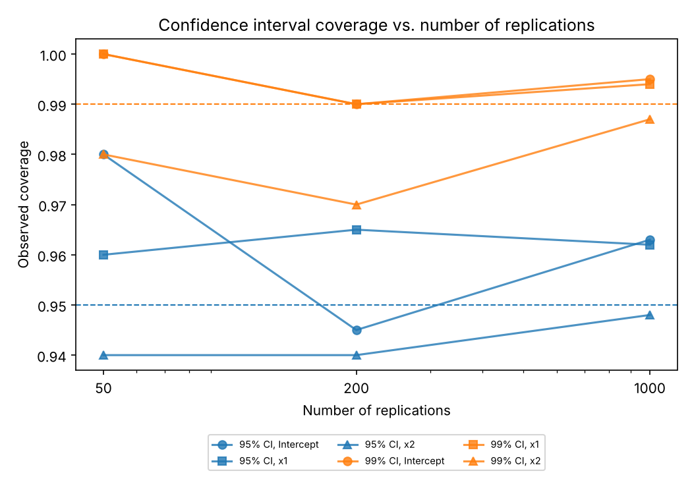
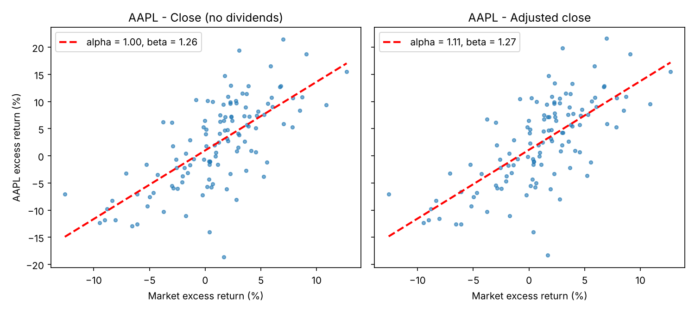

# Econometrics in Python

Python implementations of core linear regression methods, from estimation to
statistical inference, with an application to asset pricing models.

The code started as weekly exercises for an undergraduate Econometrics course
(2024). For this repository it was rewritten and reorganised by topic,
errors in the original versions were fixed, and repeated code was turned into
reusable functions.

## Contents

| Script | Topic | What it shows |
|---|---|---|
| `01_simple_regression.py` | Simple regression | Log-level model of CEO salary on tenure; simulation checking the algebraic properties of OLS residuals |
| `02_multiple_regression.py` | Multiple regression | Omitted variable bias (return to education with and without IQ); numerical proof of the Frisch–Waugh–Lovell theorem |
| `03_inference.py` | Statistical inference | Monte Carlo study of confidence interval coverage; F test vs. t test for a linear restriction; confidence interval for a linear combination of coefficients |
| `04_asset_pricing.py` | Finance application | CAPM with unadjusted vs. adjusted prices; adding size, value, profitability and momentum factors step by step for Apple |

## Selected results

**Omitted variable bias** (`02`): leaving IQ out of the wage equation raises the
estimated return to one more year of education from 3.9% to 6.0%. The script
confirms the bias formula exactly:
short slope = long slope + (IQ effect) × (slope of IQ on education).

**Frisch–Waugh–Lovell** (`02`): regressing log(wage) on the part of education
not explained by experience and tenure gives the same coefficient (0.0920) as
the full multiple regression. The same two-step logic recovers the intercept.

**Confidence interval coverage** (`03`): with 1,000 simulated samples, 95% and
99% intervals contain the true parameters 95–96% and 99% of the time.



**Testing a linear restriction** (`03`): the F test, the t test on a
reparameterised model, and a hand-computed t test give identical p-values,
and t² = F.

**Asset pricing models for Apple** (`04`, monthly data 2014–2023, ETF-based
factors):

| Model | Alpha (%/month) | Alpha p-value | Market beta | Adj. R² |
|---|---|---|---|---|
| CAPM | 1.11 | 0.04 | 1.27 | 0.48 |
| + size, value | 0.65 | 0.17 | 1.16 | 0.61 |
| + profitability | 0.63 | 0.19 | 1.16 | 0.61 |
| + momentum | 0.62 | 0.19 | 1.14 | 0.61 |

Under the CAPM, Apple shows a significant positive alpha of about 1.1% per
month. Most of it disappears once the value factor is added: Apple loads
strongly negatively on value (coefficient ≈ −1.1, t ≈ −6), i.e. it behaves
like a growth stock, and explanatory power rises from 48% to 61%.
Profitability and momentum add little. Using close prices instead of
dividend-adjusted prices understates alpha by about 0.11% per month.



## How to run

```bash
pip install -r requirements.txt

python 01_simple_regression.py
python 02_multiple_regression.py
python 03_inference.py

# 04 needs market data: download it once, then run the analysis
python data/download_data.py
python 04_asset_pricing.py
```

Figures are saved to `figures/`.

## Data sources

- **Scripts 01–03**: datasets from J. M. Wooldridge, *Introductory
  Econometrics: A Modern Approach*, loaded through the
  [`wooldridge`](https://pypi.org/project/wooldridge/) Python package.
- **Script 04**: monthly data from Yahoo Finance via
  [`yfinance`](https://pypi.org/project/yfinance/). Price data is not stored
  in this repository; `data/download_data.py` fetches it.
  - By default the factors are built from ETF returns, a common practical
    proxy for the Fama-French factors: market = SPY minus the T-bill rate
    (^IRX), size = IWM − SPY, value = IWD − IWF, profitability = QUAL − SPY,
    momentum = MTUM − SPY.
  - With `python data/download_data.py --source french` the official factors
    from the [Kenneth R. French Data Library](https://mba.tuck.dartmouth.edu/pages/faculty/ken.french/data_library.html)
    are used instead (the site is not reachable from every network).

## Tools

Python · pandas · NumPy · statsmodels · SciPy · matplotlib

## Acknowledgements

The analyses in scripts 01–03 follow computer exercises from J. M. Wooldridge,
*Introductory Econometrics: A Modern Approach*, which were assigned as
practice in the course.
